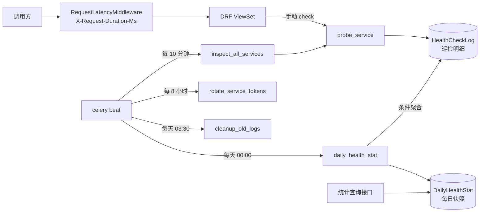

# 服务健康巡检系统

对内网 HTTP 服务做周期巡检，沉淀健康率统计，并提供 Token 轮换与敏感信息加密能力。

技术栈：Python 3.12 / Django 5.2 / DRF 3.18 / Celery 5.3 / Redis / SQLite（可无缝切 PostgreSQL）。

## 模块总览

| 能力 | 实现位置 |
| --- | --- |
| 服务 / 环境 / 负责团队多表模型 | `inspection/models.py`：`Team` / `Environment` / `Service`（外键 + PROTECT + 唯一约束） |
| 模型 CRUD 接口 | `inspection/views.py`：DRF `ModelViewSet` + Router，支持 `?env=?team=?enabled=?q=` 过滤 |
| 主动探测 API | `POST /api/services/{id}/check/`，逻辑在 `inspection/probes.py` |
| Token 定期轮换 + 加密落库 | `inspection/services.py::issue_token` + `tasks.rotate_service_tokens`（每 8h） |
| 每天 00:00 多维度统计入库 | `services.py::build_daily_stats` + `tasks.daily_health_stat`，按「环境 × 团队 × 服务」写入 `DailyHealthStat` |
| 请求耗时中间件 | `core/middleware.py::RequestLatencyMiddleware` |

## 架构



关键点：**手动触发和定时巡检走同一个 `probe_service()`、写同一张明细表**，统计口径唯一；统计是每天对明细做一次条件聚合后**物化成快照**，查询端不再扫日志。

## 快速开始

```bash
# 1. 安装依赖（本机需可访问 Redis）
pip install -r requirements.txt

# 2. 建库 + 演示数据（--history 生成"昨天"全天巡检记录，便于立刻看统计结果）
python manage.py migrate
python manage.py seed_demo --reset --history

# 3. 三个进程（本地演示）
python manage.py runserver                                    # Web
python -m celery -A config worker -l info --pool=solo         # Windows 下用 solo 池
python -m celery -A config beat -l info                       # 定时调度
```

打开 <http://127.0.0.1:8000/> 是运维控制台首页，五个功能区：

- **巡检操作**：worker 一键启动/状态检测/日志查看；全量巡检、Token 轮换、统计重算；单服务手动体检与 Token 轮换
- **服务管理**：服务表格（探测地址、超时、启停、Token 尾号）+ 搜索 + 新增/编辑/删除/启停
- **巡检明细**：按服务、环境、健康结果筛选 + 分页
- **统计分析**：按日期切换（近 30 天）+ 每服务健康率可视化 + 环境×团队汇总
- **团队与环境**：团队/环境的增删改查（有服务引用时禁止删除）

所有写操作走 POST + CSRF；任务提交给 Celery，worker 不在时自动同步降级执行。

打开 <http://127.0.0.1:8000/api/> 是 DRF 可浏览接口。

## API 一览

| 方法 | 路径 | 说明 |
| --- | --- | --- |
| GET | `/api/ping/` | 自身存活探针（演示用的巡检靶子） |
| GET/POST | `/api/services/` | 服务列表 / 新建（自动签发 Token，明文随创建响应返回一次） |
| GET/PUT/PATCH/DELETE | `/api/services/{id}/` | 服务详情 / 修改 / 删除 |
| POST | `/api/services/{id}/check/` | **主动探测一次**，返回 `ok / status_code / latency_ms / error` |
| POST | `/api/services/{id}/rotate-token/` | 立即轮换 Token，**明文只返回这一次** |
| GET | `/api/checks/?service=&ok=` | 巡检明细（手动 / 定时都落这里） |
| GET | `/api/stats/?date=&env=&team=` | 每日健康率快照（服务粒度） |
| GET | `/api/stats/summary/` | **环境 × 团队维度汇总**（sum(ok)/sum(total) 加权） |
| GET/POST | `/api/teams/`、`/api/environments/` | 团队 / 环境维护 |

示例：

```bash
curl -X POST http://127.0.0.1:8000/api/services/1/check/
# {"ok": true, "status_code": 200, "latency_ms": 6, "error": "", ...}

curl -X POST http://127.0.0.1:8000/api/services/1/rotate-token/
# {"token": "nhYSe5...", "token_hint": "PmnY", "previous_token_expires_at": "...", ...}
```

说明：`POST /check/` 的 HTTP 200 表示「探测动作完成」，服务是否健康看响应体 `ok` 字段——探测失败是业务结果而不是接口错误。

## 设计取舍

### 1. 写入链路收敛：一次探测，一条明细

手动触发（View）和定时巡检（Task）调用的是同一个 `probe_service()`，结果统一落到 `HealthCheckLog`。如果两条链路各写各的表，「按需探测算不算进健康率」就会变成口径问题——这里从结构上消灭了它。

### 2. 统计物化：先删后插 + 唯一约束

- 聚合用一条 SQL 完成：`values(...).annotate(total=Count('id'), ok_count=Count('id', filter=Q(ok=True)))`，分子分母一次拿到；
- 没有巡检记录的服务**补 0 行**，否则报表会静默漏服务；
- `DailyHealthStat` 对 `(stat_date, service)` 建唯一约束，任务重跑幂等（先删当日再 `bulk_create`）；
- 统计行在写入时同时落 `env_id / team_id`，相当于对归属关系做了快照：之后服务换团队，历史数据不会被改写。

### 3. 敏感字段：只存密文，明文路过不留痕

- Token 用 Fernet 加密落库，密钥种子来自环境变量（`FERNET_KEY`），库里被拖走也解不开；
- 列表页只暴露 `token_hint`（尾 4 位），避免「为了看一眼」去解密；
- 轮换时旧 Token 保留 **10 分钟宽限期**（`previous_token_expires_at`），避免轮换瞬间并发巡检集体 401；过期后的旧密文由清理任务定期擦除。

### 4. 中间件：为什么这么写

- `time.perf_counter()` 而非 `time.time()`：单调时钟，不受 NTP 校时影响；
- 排在 `MIDDLEWARE` 第一位：Django 中间件是洋葱模型，最外层才能覆盖所有下游耗时；
- 计时在 `finally` 里：视图抛异常时也要记录，否则最慢的请求恰好不可见；
- **只打日志不落库**：每请求一次 INSERT 会拖垮 QPS，耗时属于高写入低价值密度数据，走结构化日志 + 慢请求阈值告警（响应头 `X-Request-Duration-Ms`）。

### 5. 并发巡检：线程池而不是拆子任务

全量巡检用 `ThreadPoolExecutor` + 每线程一个 `requests.Session`（`threading.local`），结果统一 `bulk_create`。拆成 N 个子任务会让 broker 消息数随服务数线性膨胀，汇总还要二次同步。

### 6. 时区是定时任务最大的坑

`USE_TZ=True` 时库里是 UTC，统计窗口必须 `make_aware(北京时间 00:00)` 再比较；Celery 侧 `CELERY_TIMEZONE=Asia/Shanghai` + `CELERY_ENABLE_UTC=False`，否则 `crontab(hour=0)` 会偏 8 小时。

## 生产化建议（明确没做、但知道该怎么做）

- 认证：接口默认 `AllowAny`，生产应接 JWT / SSO + 数据权限；
- 存储：SQLite 换 PostgreSQL 只改 `DATABASES`，明细表按月分区 + 冷数据归档；
- 告警：健康率跌破阈值时推送 IM，可复用 `DailyHealthStat` 生成时的结果判断；
- 观测：中间件输出接 OpenTelemetry / Prometheus，`exemplars` 关联慢请求日志；
- 驱逐策略：`cleanup_old_logs` 目前单次删除，量大时应按主键分片。

## 版本说明

`requirements.txt` 锁定 `celery==5.3.6 / kombu==5.3.7`：kombu 5.5+ 的绑定脚本使用 Redis 6.2 才支持的 `ZADD ... GT`，在 Redis 5.x 上 worker 会直接 `ERR syntax error` 崩溃。
